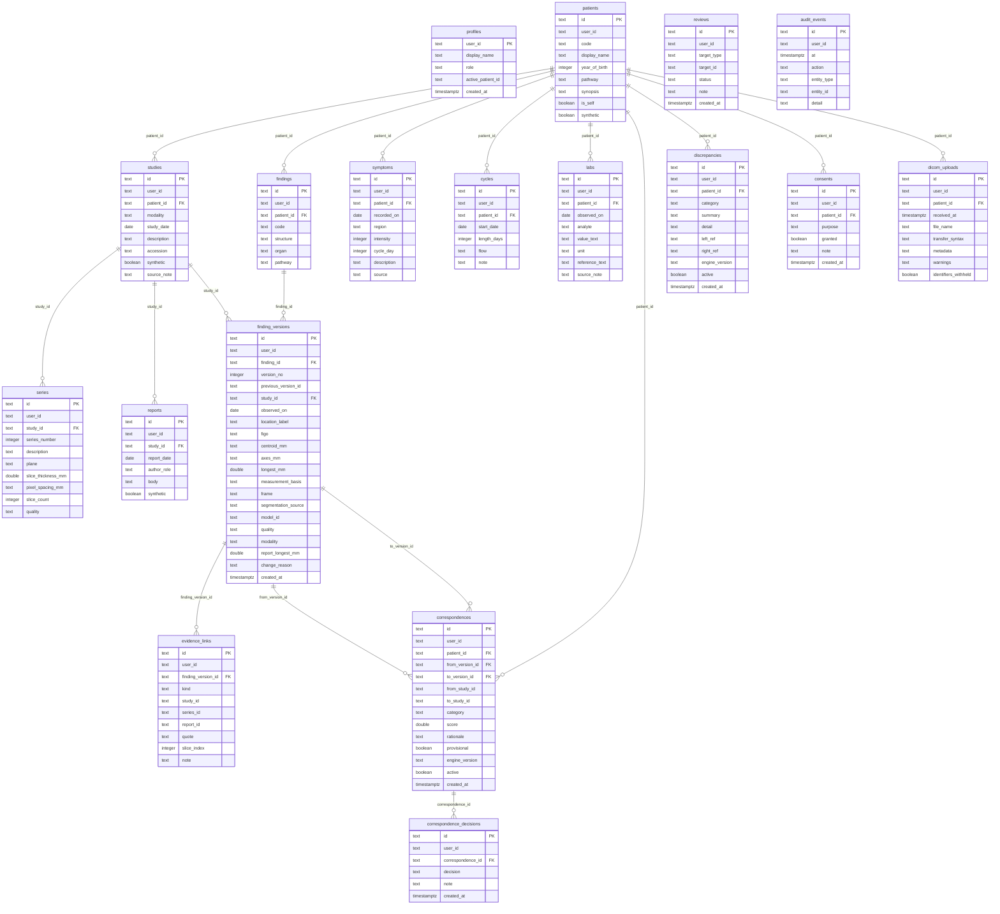

# ER diagram

Generated from `migrations/0002_anatomybridge.sql` by parsing `create table` blocks and `references` clauses, so it matches the schema as written. Auth tables (`migrations/0001_auth.sql`) are not shown.

## Entities in the master prompt that have no table yet

Users/permissions beyond a per-account role (`profiles.role`), clinician entity, imaging instances (per-slice rows), segmentations, measurements as their own rows (they live inside `finding_versions`), follow-up examinations, AI model versions as a table (a code list `MODELS` exists), and processing history. Each is a candidate for migration `0003` once the imaging pipeline writes real outputs.
